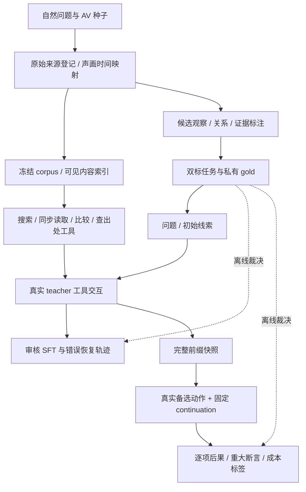

# Research Plan v2：Learning Evidence Acquisition for Multi-Source Audio-Visual Deep Research

> 工作位置更新（2026-10-10）：用户最新指定 `coder ssh 3`，仍使用 `/home/jovyan/OneSearch-VL`。本文的 workspace 2 及当时能力状态是历史计划/运行快照；最新实况见 [研究入口](README.md) 和 Phase 1 验收报告。研究方法与 gate 仍按 v2 执行。

日期：2026-10-09（Asia/Shanghai）。论文定位：多模态取证决策方法。范围：独立的多源 Audio-Video search、证据核验和研究报告；Search for Generation 留作后续论文。

本文整合 v1 方法方案、数据管线设计与 OneSearch-VL 真实复现审查，作为当前研究执行依据。v1 保留历史版本。本文中的方法收益、数据规模、预算和排期均为待验证方案；只有“当前状态”表中的执行结果已经发生。

**执行主线：10 案完整证据包 → 40 案探索 → 80 states 的真实分支信号 → 同标签 Q / 强规则比较 → 条件扩量 → 冻结正式评测。** 不以完成官方全量 benchmark 或完整 agent SFT/RL 为进入本项目研究的前提。

## 1. 研究问题与可检验主张

我们研究：面对尚未确认的声画归属、跨源事件对应和来源依赖，能否学习预测一次检查会改变哪些目标结论，从而在相同信息和资源上限下取得更可靠的研究报告？

方法的候选主张是：**目标条件下的联合 AV 绑定状态，加上真实备选行动的逐项后果监督，可以提高证据获取效率、减少错误绑定传播，并泛化到新的依赖组合。** 只有对强对照的实验支持后才写成论文结论。

三个假设：

- **H1，绑定与依赖。** 可修订的联合解释及其对目标项的影响，比持有完全相同信息的 flat ledger 更有效地减少错误组合。
- **H2，后果学习。** 同前缀执行的真实备选检查，能提供有用监督；显式逐项后果聚合在同标签、同 encoder 的 Q 对照下有样本效率或组合泛化增量。
- **H3，任务适应。** 同一历史改变目标项时，有用的检查随之改变；增加转载或无关歧义不会机械增加证据置信度和调查开销。

候选英文标题沿用本文件标题。贡献不预先定义为“首个 AV researcher”；AV 图、主动听看、audio-driven search、引用 reward、VoI 和 action-value learning 均有近邻。

## 2. 当前状态、代码基础与条件依赖

| 项目 | 当前可确认的状态 | 对本计划的含义 |
|---|---|---|
| codebase | 用户 fork MichaelCao0/OneSearch-VL；branch research/av-deepresearch；baseline 0b7b01ed4872aaccd9af0f6f3d23a81814cf55bd | 主开发继续在该 fork，不建立另一个主栈 |
| 环境 | coder ssh 2，/home/jovyan/OneSearch-VL；Pixi default CPU inference 环境 | 数据登记、预处理、索引和小量视觉运行可在这里起步 |
| GPU | 本轮 live 检查 /dev/nvidia* 为空，torch CUDA unavailable | 原生 AV observer 与训练须先重新验证设备，CPU smoke 不证明 GPU 就绪 |
| 发布 8B | CPU BF16 真实 load；图像 red square；视频 select_frame→真实 PNG→THANKS FOR WATCHING，完整响应、无工具错误 | 验证了视觉 controller 与本地工具闭环，没有验证 audio 或自主定位 |
| 检索开关 | ONESEARCH_DISABLE_RETRIEVAL=1，7 项回归通过；默认 prompt 保持发布内容 | 仅关闭本轮远端搜索；新 local-corpus 研究工具单独注册，不伪装 Serper |
| 公开资产 | pinned 模型 hash 与 1-video/128-frame 官方 subset 校验通过 | 不等于307案 benchmark、SFT/RL或完整数据合成已复现 |
| 数据合成 | 公开主分支与 HF 发布未找到完整 VGEG 生成 pipeline；论文 Appendix A 说明 prompt templates omitted | 本项目需要自己的 AV data engine；利用已有格式与训练接口 |
| 新研究能力 | 自然案例、AV observer、evidence registry、branch runner、selector 尚未实现 | 后文明确为设计与执行任务 |

完整复现证据见同目录 OneSearch-VL-8B-local-reproduction-2026-10-09.md / 对应 evidence JSON。没有 commit、push、PR 或公开数据发布。

候选 observer 可评估开放原生 AV 理解模型（例如 Qwen2.5-Omni-7B 或 Qwen3-Omni 系列）或后来明确授权的服务；这些是候选，不是已验证部署。必须以真实输入、接口与语义 preflight 选择并锁定，不以品牌或工具名证明联合 AV 能力。当前无需 Serper 或 Gemini，即可先建立本地冻结 corpus。

## 3. 近邻工作与创新边界

| 近邻 | 前期阅读识别的机制 | 本研究必须证明的额外内容 |
|---|---|---|
| OneSearch-VL | VGEG 数据监督、视觉工具与 EVGR | 原始音频、可修订跨源绑定与下一步检查效用；增加工具不是方法收益 |
| OmniGAIA / OmniAtlas | AV event graph、主动听看、外部扩展、OmniDPO | 同状态实际备选行动的监督，以及同信息强对照下的增量 |
| Omni-DeepSearch | audio-driven search、候选粗查/细查与 query 修正 | 结论依赖与来源关系怎样改变动作选择 |
| STAMP | 单条已执行轨迹的引用验证和 first-exposure attribution | 同前缀真正执行未选动作；不能称首次 action-level evidence supervision |
| CaRR / Chaining the Evidence | 引用、答案依赖和过程 reward | 获取决策与 AV binding 的任务适应性 |
| ProMMSearchAgent | tool-free probes、宏观工具调用监督 | 具体下一步检查及其真实后果 |
| HiEviDR-Bench 与主动取证/VoI 文献 | 证据层次、可追溯报告、信息价值 | 不能将 graph、planning 或 grounded-report evaluation 单独当新概念 |

以上是前期阅读边界，不是穷尽查新。G0–G2 期间补查 active information gathering、belief planning、source dependence、claim verification 和 action branching；冻结一张 mechanism matrix。若新的工作计算图与本方法相同，调整主张或对照，不靠重新命名维持创新。

若 task-aware VoI 使用和本方法相同的预测分布、效用及候选，其期望效用与逐项聚合等价，只作 sanity check；有区别的 belief/VoI 对照必须写清观察模型及更新近似。

## 4. 任务定义与统计单位

每案输入为一个自然研究问题、3–6 个公开目标项、1–2 个初始 AV 线索，以及可检索的冻结媒体/网页环境。输出为逐项结论、引用片段/原文、证据边界及综合报告。

目标项区分两个维度：事实结论（例如 same event / different event / unknown），以及对明确命题的 supported / contradicted / undetermined。Gold 同时规定结论和证据充分性；不能只看措辞或 final answer。

自然任务族：

| 领域 / 操作 | 问题示例 | 可裁决边界 |
|---|---|---|
| 技术示范、维修、产品操作 | 异响发生在什么操作阶段？评论针对本次操作还是类似示范？ | 允许阶段与对应判断；异响不直接证明唯一故障或物理原因 |
| 活动、演出、现场记录 | 某声音与哪段可见事件相邻？报道是否引用同一录制？ | 允许时间/出处判断；掌声相邻不直接证明观众动机 |
| 动物、环境、公共声景 | 声音与哪些可见或画外候选相容？其他来源能否缩小范围？ | 证据不足时保留身份、地点、声源未知 |
| 跨领域来源核验 | 口头/网页主张是否有原始记录支持？多URL是否独立支持？ | 区分自述、直接观察与独立录制，容许冲突与未知 |

任务先有自然问题草稿，再收集材料确定能回答的范围；LLM 只提出候选表述，最终由审核者接受。主结果使用真实自然 AV；人工配音、乱序、移位和遮挡仅作单列 stress tests。

**独立样本单位为原始事件及其媒体谱系簇。** 多段录制、转载、问题、轨迹、分支、seeds 和扰动均不扩大独立案例数。同事件/同录制/同实体/同类操作为不同关系；来源关系 unknown 不强制变成 independent。

## 5. 数据引擎总览与产物

六类正式产物互相链接但访问权限不同：

1. **Source registry**：原始媒体/网页、版本、hash、来源信息与派生映射。
2. **Frozen corpus**：actor 可搜索的真实公开内容与索引，保持自然 metadata。
3. **Task/gold packages**：公开问题与私有目标判定、可接受证据集、来源谱系。
4. **Executed trajectories**：真实请求、观察、模型输出、成本、错误与引用。
5. **Branch supervision**：同前缀候选的真实执行结果，适用于 selector 和强对照。
6. **Split/evaluation manifests**：事件簇划分、协议、judge、模型/工具版本与统计分母。

不以自动生成的 QA 数量作为主要数据质量指标。每批分别报告原始事件簇、来源、目标项、审核任务、完整轨迹、decision states 和 branch suffixes。

## 6. Stage A：来源采集、原始媒体与时间映射

### 6.1 采集与版本

优先使用可稳定获取、可注明出处的自然公开素材：原始技术示范/操作记录、公开现场录制、环境/动物实录及关联资料。现成单片 AV 数据集可以提供种子，但它们的标签不能替代跨源证据 gold。初批人工检索可用网页与已知原始 URL，不依赖 Serper。

逐来源保存 origin URL、获取时间、公开标题/描述、文件 bytes/hash、许可/发布依据及可获取性。网页quote保存页面版本hash、原文摘录及字符/段落定位。源网页保存实际 body、quote 定位和版本，不能以模型摘要当原文。失效和获取失败记录到 coverage。

优先选择可再分发素材；不能再分发原媒体的来源，交付 URL/hash/标注与 replay recipe，公开发布前逐资产确定发布范围。当前采集/设计不因此引入额外泛化审批流程。

### 6.2 原始时钟

以 source-local presentation clock 表示所有区间 [start_s,end_s)。保存 stream time_base、start_time、帧 PTS、音频采样映射、声画 offset 和 VFR 信息。timestamp_origin 定义为来源公共播放轴的起点；负 offset、变速/剪辑均显式记录，不自行对齐成同一 clock。

原始文件不重定时；ASR 音频、关键帧、缩略视频及 clips 为派生视图，保存 parent hash、transform、工具版本和精确映射。不得把原始音轨直接拼到 OneSearch 的 1-fps 重定时 grid。

同步验收采用可测的原始声画标记与已知 offset fixtures；报告 observed offset/error，项目初始容差取 100 ms。自然素材原有不同步不被“修成真值”，应作为来源属性；超过工具容差时拒绝该次处理或标注 timing uncertain。跨源映射是单独的证据关系，不因时长/内容相似自动成立。

### 6.3 存储

原始资产、receipts 与版本化 manifests 放持久盘；/tmp 只放可重建 cache。原始 AV 不全量展开 PNG；按需解码关键帧/区间，内容 hash 去重，保留删除 cache 后可重建的路径。

初始10案采集硬上限：独立自然事件簇10、唯一源资产60、原始 AV 总时长20小时、持久资产50 GB、临时cache25 GB，四项先到者停。上限是首批探索约束，不是正式数据规模；不足以形成10案时报告产率并调整来源策略，不偷偷扩大。

## 7. Stage B：冻结 corpus 与多模态检索

首版 corpus 是一个跨任务可搜索的来源池，包含有效来源和自然近似干扰；至少有同类操作的另一录制、同录制转载和相关但不够裁决的材料。不要按 task_id 返回预先标好的 gold sources。

| 通道 | 可索引内容 | 初始路线 |
|---|---|---|
| 文本 | 公开 metadata、ASR、OCR、网页原文 | BM25/全文检索先验证，再加入锁定 text encoder |
| 视觉 | 来源帧与局部图像表示 | 锁定 image/video encoder；候选返回后由实际片段复核 |
| 音频 | 音频区间表示、指纹 | 锁定 audio encoder/指纹；相似命中是候选，不是 identity gold |

预计算 ASR/OCR/embeddings 属于 corpus 公共处理，由所有机制对照共享。模型生成的非语言声学描述首版不直接进入文本索引，避免用摘要提前回答听觉问题；若后来加入，应作为单独 recipe、在模态遮蔽时一起去除，所有比较共享。

每次搜索记录 corpus/index/retriever/config hash、query、rank/score、返回内容范围和 cost。依次锁定文本检索、视觉检索、音频检索的 native probe；每个通道报告候选 coverage，不承诺它们具有相同语义。

索引仅含 actor 可访问的真实公开内容和明确 derived 字段，不放 gold、隐藏关系、审核结论、题目生成 prompts 或未来 observations。source_id/文件名使用不编码身份或标签的 opaque IDs；原来源实际公开标题仍保留。

先按事件/谱系 split，再分别构建对应的冻结 corpus；近重复跨 split 清理后，公开通用参考材料可共享但清单显式声明，不能携带测试事件的答案内容。检索范围与 unknown 判定同一 manifest。

## 8. Stage C：候选证据、关系与任务 gold

### 8.1 证据类型与审核

候选生成器可提出事件分段、声学事件、可见对象、口头主张、共享素材和跨源关系；它的输出只有 candidate 状态。

- Direct observation：可听/可见内容及位置。
- Source assertion：作者/解说/网页声称什么，不自动等于事实。
- External fact：资料支持的知识，保存原文与出处。
- Binding：声源/对象/事件/录制/跨源时钟的对应，独立接受或拒绝。

**Tool receipt verified 仅说明字节、区间和调用已执行；不能证明 observer 的描述正确或 binding 成立。** 运行时 ledger 保存原始receipt、模型 observation、局限与可复核引用；只有独立语义裁决能决定 gold support。

例如声学撞击与画面接触同步，可分别作为 observations；“撞击由该对象造成”是待审核关系。音频指纹匹配可提示共享音轨，不单独证明同一视频、同一事件或伪造。

### 8.2 有效证据集合

每个目标项保存明确 proposition/qualifiers、结论、支持/反驳/不足状态、一个或多个可接受 evidence packages、必要 bindings 和缺失证据。包内为 AND，包间为 OR。独立裁决可接受 corpus 内新的等价证据路径，保留扩充记录并对全部方法一视同仁。

undetermined 限定为当前冻结范围：指出缺失的对应、身份或原始出处，并引用相容/冲突材料。没有搜到不等于事实不存在。存在可裁决证据却回答 unknown 为0分。

自然问题草稿与 evidence package 互相校正，但不得为 teacher 的想象答案补故事。题目/目标项不强含未验证事实；少数只有部分可裁决的案例可以保留局部 unknown，公共证据无法支持且未知原因也不可解释的题拒绝。

### 8.3 标注工作流

A/B 两名标注员独立看原媒体与资料，提出目标项状态、引用、必要关系及声学需求；第三次裁决合并分歧。模型可预标但不代替独立标注。记录逐项 agreement、citation/timing 争议、关系 unknown 与裁决耗时。

首批10案至少8案能形成可裁决包；100%关键证据具有 source/hash/区间或quote定位。初始重大分歧比例若超过20%，先修定义再标；该阈值为pilot QC，不是统计可靠性证明。

正式gold和输出judge分开维护；输出至少20%双评、所有重大断言/低置信/冲突由人工复核。自动 judge 先在20–30个探索案例上与人工校准，报告 disagreement，不能因同系列 teacher/judge 一致就声称独立真值。

## 9. Stage D：AV 必要性、近重复与数据划分

逐目标项标注 speech-sufficient、non-speech-acoustic、joint-AV-binding 和视觉/文本足够的 controls。两名标注员在 metadata-only、ASR-only、ASR+frames、raw AV 条件下审核是否有充分证据；模型差异只是实验现象，不作为模态必要性的定义。

遮蔽 audio 时，去掉原始音轨及来自它的非语音声学标签、摘要、指纹/embedding访问和类似 [applause] 的字幕信息。纯词级转录和由它生成的文本检索保留在 ASR 条件；真实公开 metadata 一致保留。ASR+frames 仍包含全部视觉来源内容，不通过删减视觉预算制造 raw AV 优势。

audio fingerprints、视频近重复检测和人工谱系核查共同建立 recording/event connected components；剪辑和扰动跨 split 被自动拒绝。若通用页面连接不同事件，不因这一个参考页合并全部事件；区分共享知识与共享事件证据。存在疑似同事件但无法拆开的簇保守放同 split 或进入 exploration，不用 URL/hash 去重冒充事件隔离。

明确挑战子集可探索后冻结约20%的 undetermined 目标项，但该比例不是现实自然比例；同时报告 naturally sampled core 和 challenge strata。第一批不强填笛卡尔积，不按方法test失败筛题。OOD 优先选择本项目训练中没有出现的依赖组合，主题和录制条件尽量配平；“未见”仅指本项目训练，不保证基础模型预训练没见过素材。

测试 blueprint、来源范围、采集标准与 private gold 在G2后由独立人员冻结；方法团队不看test结果。Test gold可以在G3后投入全量标注，但标准不得按方法结果重写。

## 10. 数据契约与可见性

首版使用 JSONL manifests + 内容寻址原始文件 + SQLite/全文索引即可；embedding索引按需加入，不先引入图数据库或分布式平台。下面为设计schema，不代表文件已经生成。

| Record | 必须字段 | 可见性与约束 |
|---|---|---|
| SourceRecord | source_id, origin_url, fetched_at, media_type, asset_bytes, duration_s, asset_sha256, rights_basis, redistribution_scope, public_metadata, stream_specs, timestamp_origin, access_status | URL/真实metadata可见；资产root与私有目录不进入actor |
| DerivedRecord | derived_id, parent_sha256, transform, tool_version, original_interval, mapping, output_sha256 | 工具可用内容与精确原始映射；区间合法 |
| SearchReceipt | corpus/index/config identity, query, modality, ranked_results, returned_content, logical_cost, actual_cost | 仅真实搜索结果；不按gold筛选 |
| ObservationReceipt | call_id, source/hash/interval, input_artifacts, model/version/config, raw_output, observation, uncertainty, error, cost | 执行可核验；描述仍待语义审核 |
| TaskPublic | task_id, question, target_questions, initial_sources, corpus_id, budget_recipe | 不带答案、有效来源清单、hidden bindings |
| ClaimGold | claim_id, proposition, expected_decision, status, qualifiers, valid_evidence_sets, required_bindings, missing_evidence, scope | 私有评测/审核；包内AND、包间OR |
| LineageGold | recording/event IDs, relation_type, relation_status, basis_refs, adjudication | 私有；真实公开出处内容可以留在corpus |
| PrefixSnapshot | messages, observed_receipts, hypotheses, dependencies, budget, candidates, versions, cache/RNG, no_inflight | 没有gold/未来观察；可不可变克隆 |
| BranchLabel | prefix_id, action_id, logging_policy_id, seed/receipt IDs, final_claim_scores, major_error, remaining_cost, immediate_aux, masks | 离线训练监督；统一horizon；不成为测试时observation |

所有记录有 schema_version、创建者/工具身份和revision。validator检查引用存在、区间界限、hash、split、private字段泄漏、工具schema和缺失状态；error/unknown是明确值，不用空白误当成功。

## 11. 工具环境、AV observer 与 teacher

### 11.1 最小研究工具ABI

建议研究adapter与官方工具分开，接口按原始source-local interval：

~~~text
search_sources(query, modality, corpus_id, top_k) -> SearchReceipt
inspect_av(source_id, start_s, end_s, mode, resolution_recipe) -> ObservationReceipt
compare_segments(segment_a, segment_b, relation_question) -> ObservationReceipt
inspect_provenance(source_id, corpus_id) -> ObservationReceipt
finish_report(public_targets, observed_receipts) -> Report
~~~

corpus_id由episode运行配置固定，actor不能切换split/私有corpus；source_id和引用须属于当前可见来源池，越权请求明确拒绝。inspect_av 必须返回真实同步媒体及observer内容；compare/provenance可以报告 unknown。来源身份/关系由实际可见材料推断，工具不能暗查 LineageGold。非原始AV的ASR+frames模式明确标记 mode，不宣称联合听看。

ASR/decoder/index可先在CPU运行；原生 AV observer部署后跑至少8个带人工判定的probe，覆盖语音、非语音、画外声、旁白、局部同步、静音/遮蔽、错误时间区间和来源歧义。检查实际audio/video bytes消费、时间映射及内容描述，不只检查HTTP200。10案校准observer上界；通过后固定backend/model revision/prompt/采样限制/错误策略。

若仅ASR+frames可用，继续registry、gold、索引与格式pilot；停止宣称raw-audio能力，正式H1/H2 AV试验等待真实observer。这是能力依赖，不是要求重新复现全部OneSearch benchmark。

### 11.2 Controller/observer/writer分离

发布OneSearch 8B先作为controller候选；它本身是视觉模型。固定AV observer读取原始片段，返回可复核记录；固定candidate generator、updater、writer与logging continuation，首轮只学习selector/consequence model。必要时用20–50条审核cold-start轨迹修工具格式，所有机制对照共享同一checkpoint。

teacher不拿gold，必须真实执行工具；不让LLM写假的observations。保存raw response、严格JSON解析、tool request/receipt、重试和关闭response。重复JSON key必须明确拒绝并修复，或保留原稿并记录规范化规则；先前8B smoke的同值重复name不作为训练合法调用直接吞掉。

独立审核支持替代正确证据路径。失败、空搜索、无效检查和恢复都留在原始trajectory库；成功/审核恢复轨迹导出SFT时只对合法policy tokens计算loss，observations/provider错误正文只作上下文。错误动作若进入纠错训练，显式区分bad action与corrected target，不当作成功expert action。

teacher不能用gold指定的来源或frame偷偷引导controller；工具格式probe可以显式给位置但单列，不能混进自主定位评测。Same-family judge只作为自动QC。

## 12. 方法：联合证据状态与逐项行动后果

### 12.1 状态与动作

运行时状态为 S_t=(O_t,H_t,D_t,B_t)：已观察记录、3–5个可修订联合解释（含none-of-the-above）、目标依赖、剩余预算。首轮每个state只关注一个关键未决绑定，不训练开放世界任意图生成器。

H可包含同次事件/同类操作、现场声/旁白/画外声、同录制转载/独立/unknown的联合解释，必须满足互斥与时间一致性。D由当前可见历史生成，不能取gold graph。flat对照得到同样关系内容，避免图模型多拿信息。

全部selector使用共同候选生成器，每state至多4个候选，stop是其中一项；动作来自同步重读、比较片段、检索新来源、查原始出处/相反证据、交付。机制扩展时可增至8，须另锁recipe。

预测未来观察只影响选动作，不写入已取得ledger，不作为报告引用。动作执行后共同updater根据真实receipt修订假设；unknown与撤销既有绑定合法。不同解释若对目标结论影响相同，不必为消除无关歧义继续花预算。

### 12.2 主监督与损失

主标签统一定义为：执行候选a，再由冻结logging continuation完成后，最终各目标项是否满足GCR、报告有无重大无依据断言、这一动作加后续的真实剩余成本。

~~~text
Y(t,a) = (g_1,...,g_m, r_major, C_remaining)
predictor outputs: (p_1,...,p_m, p_major, C_hat)
L = mean_j BCE(p_j,g_j) + beta*BCE(p_major,r_major) + gamma*Huber(C_hat,C_remaining)
V(S,a) = mean_j p_j - alpha*p_major - lambda*C_hat
~~~

每案m可变；用mask处理缺失审核，案内归一化。即时binding确认/撤销/未知、新独立证据/重复/不可判作为辅助头，与终止horizon主标签分开；从该次真实观察独立审核，不能用最终报告倒推。

stop分支只让冻结writer根据当前观察完成报告，没有调查suffix；成本仍含writer。统一hard cap先决定可执行动作，再比较V，预测便宜不允许超预算。每次检查前预留finish_report的writer credits；若连预留都不足，按预定budget-failure协议交付已有部分或记录失败，不能免费补writer。alpha/beta/gamma/lambda、校准和stop规则在train/dev选择并在test前冻结。

第一版是目标条件下的action-consequence predictor，不是通用world model。先一步选择；出现互补行动必要性才加两步lookahead，并加入同预算两步对照。

## 13. 真实分支数据与快照验收

每个PrefixSnapshot保存完整messages、registry/observations、hypotheses/dependencies、budget/cost、共同candidate set、工具/索引/observer/controller/writer身份、cache key/RNG/seeds、无inflight状态。普通trajectory JSON和跳过完成case的resume不能替代它。

分支从不可变克隆起步。对同prefix的4 actions真实执行，使用配对的2组可控continuation seeds，在相同总资源上限内继续。服务不可seed的随机性另外记录请求/版本/repeats，不称严格因果反事实真值。

Prefix replay验收：已观察receipts相同、budget/candidates/versions一致、没有未来信息，branch间不会互写registry或cache可见状态。共享物理cache可以省钱，但决策前逻辑cache identity一致，cost按照共同未缓存pricebook计算，并另记录实际服务费/latency。

标签估计是 Q_pi_log(S,a)，不是最优Q*或动作普遍价值。冻结continuation可能用坏好证据或补救差动作；至少20 states用第二continuation诊断。排序接近/重复翻转的动作标tie，不强造唯一最优；两次repeats只供初筛，不足以精确估计每个动作期望。

候选覆盖单独审核：存在有用检查但未被候选器提出，是generator失败；有候选却选错才是selector失败。工具失败与检索落空进入分支标签，不过滤为全成功数据。测试每步只执行被选动作，绝不跑完所有branch后用private gold挑最优。

若cold-start/updater/continuation改变，旧labels仍描述旧policy；保存身份，必要时重采受影响分支并记费。

## 14. 训练顺序、强基线与机制实验

### 14.1 训练顺序

1. 先freeze工具/observer/writer，用预训练controller检验合法动作和任务上界。
2. 必要时共享20–50条cold-start轨迹，核验工具合法性；不把完整agent SFT当首要目标。
3. 80 train decision states × 4 actions × 2 repeats = 最多640 suffix episodes，测候选覆盖、成本和排序稳定性。
4. 首轮80–150 train事件簇上的selector/consequence训练，事件隔离dev选择模型/阈值。
5. G3通过后主分支最多300 states ×4×2=2,400 suffixes；这替代640而非叠加。另留最多320敏感性suffixes。
6. 只有controller行为成为瓶颈才扩完整teacher至300–600 train簇，每簇至多3 episodes，即≤1,800；普通RL/过程RL为可选，不是方法论文必要条件。

selector可先在固定表征上训练小共享encoder/heads检验信号，再用GPU进行controller adapter；若表征不足而未训练7–8B，不提前断言方法失败。所有比较共享训练版本及实际参数预算。

### 14.2 必需对照

| 配置 | 必须共享/配平 | 主要回答 |
|---|---|---|
| Proposed：逐项后果显式聚合 | 共同encoder、所有标签、候选和预算 | H2的目标机制 |
| Scalar Q + auxiliary heads | 与Proposed同输入/encoder/参数规模、逐项/绑定/来源标签与辅助损失；Q目标为同一Y经相同效用聚合 | 结构化聚合是否超过同标签整体价值学习 |
| Scalar-only Q | 同轨迹但仅聚合标签，另列 | 监督密度诊断，不作为H2充分证据 |
| Claim-risk / cost规则 | 同状态/关系/候选；阈值dev调优 | 是否只是简单规则即可解决 |
| Task-aware belief/VoI | 明确观测模型、belief更新、效用/成本近似 | 是否超过相邻主动取证方法；等价情形只作sanity |
| Flat ledger | 同全部证据与关系内容 | H1是否来自关系计算而非更多字段 |
| 同数据trajectory imitation / correction | 训练数据和policy初始化相同；报告branch额外标签差异 | 实际备选检查监督是否有价值 |
| 系统参照 | OneSearch+audio-tools ReAct、ASR+frames pipeline、强long-context、可运行Omni类系统 | 报告系统位置；不同backbone/observer的差异不归因方法 |

过程训练优先选nearest-neighbor的CaRR/EVGR-style依赖reward或STAMP-style已执行归因，用相同已执行/branch数据注明适配，不冒称完整官方复现。新reward模型不是另一条并行贡献。

### 14.3 三种核心机制及消融

- Claim switching：同一历史，问“同次事件”或“同类操作”，检查选择是否随目标改变。
- Copy invariance：增加同录制转载，独立支持和结论不应提高。
- Unknown recovery：初始候选全错，新证据能否撤销并进入none-of-the-above。
- 模态：metadata-only / ASR-only / ASR+frames / raw AV，遮蔽派生信息。
- 即时绑定、可修订解释、去掉目标依赖、来源谱系开关。
- 无关歧义、相同claim/不同来源关系、依赖新组合。
- Oracle retrieval / observations / bindings上界，仅诊断；不能列入公平方法榜单。

优先在exploration/dev做完整矩阵，正式test只做预注册主对比和固定子集诊断。不能从多项诊断中选最好的一项替代失败的主结果。

## 15. 指标、评测审核与统计

主要指标GCR：每个目标项同时满足 decision correct AND sufficient evidence AND valid source/time citation 才计1；案内平均，再按独立事件簇宏平均。

~~~text
GCR = mean_event_i [ mean_target_j 1(correct decision AND sufficient supported evidence AND valid source/time citation) ]
~~~

unknown在可判定项计0；在冻结范围确实不可判定项，正确说明缺口/冲突且引用有关材料才得分。若undetermined权重约20%，全unknown上限约0.20，空报告不因precision得高分。Gold接受有效替代证据包。

同时报告strict task success、major unsupported assertion rate（含目标外的新断言）、event/entity/source binding error、duplicate-as-independent error、citation support、时间定位质量、独立来源coverage、总cost/latency与达到目标质量的成本。媒体读取成功不代替observer语义grounding。

自动judge先校准，全部方法输出混排盲评；正式至少20%输出双评及所有冲突/重大断言复核。记录模型/服务版本、失败率和coverage；case/tool/judge失败不从分母消失。训练缺失标签可以mask；正式未裁决项走预注册人工复核/失败规则并保留分母，不能通过mask删除。同源模型judge的一致性不等于独立事实证明。

主比较固定为Proposed vs. same-label scalar Q + auxiliary heads，以正式支持H2；具体模型/阈值仅在dev调优并锁定。最强claim-risk/cost规则必须在dev参加G3门槛，并在固定60案正式子集与flat ledger列作诊断；若强规则dev持平或更好，不以只胜Q维持新方法主张。两类对照的完整dev曲线留存，不在test看结果换baseline。主目标固定为同budget GCR提升；成本节省为secondary，只有预先另立主协议才转为同质量成本主张。

规划最低实用增量取GCR +5百分点；该阈值在40案校准后、test前冻结。主要统计为事件簇paired bootstrap 95% CI，先聚合case的seeds；IID300独立于OOD120。OOD重点是预定未见依赖组合，不将120案例拆成很多小shift后声称普适泛化。

样本规划：n≈7.84*sigma_d^2/delta^2。sigma_d=0.25–0.40时n=300对连续GCR约能检测4.0–6.5点，这是规划假设不是保证。Strict success若discordance=0.2–0.4，300案约能检测7.2–10.2点；5点可能需627–1,254案。先以exploration盲态估计方差；不根据已见test不显著反复加样本。

重大断言差异给CI。候选非劣性容差+2点在dev冻结；300案且discordance0.10、观测差异0时双侧95%上界仍约+3.6点，不足以声称非劣；压到+2点可能需约960案。无法排除恶化时限制可靠性表述，不假装“无显著差异”证明安全。

## 16. 样本、运行与人力预算

### 16.1 数据阶段

| Split / 产物 | 规划规模 | 说明 |
|---|---:|---|
| Exploration | 40事件簇，含最初10案 | 任务、observer、费用与机制校准；不进入test |
| Train | 首轮80–150，条件扩至300–600事件簇 | states/episodes不是独立事件数 |
| Dev | 首轮40–60，必要时100事件簇 | 选择baseline/阈值/预算；不进入test |
| IID test | 300独立事件簇 | 唯一正式主比较样本 |
| OOD test | 120独立事件簇 | 预定依赖组合；单列统计 |
| 初始branch | 80 states×4×2=640后缀 | train来源，只验证信号 |
| 主branch扩量 | 总计300×4×2=2,400后缀 | 已含640；另≤320敏感性后缀 |

最大自然案例规模40+600+100+300+120=1,160事件簇。不是本轮已批准立即生成的批次；每阶段需前一门槛通过和实际资源配置。Test由独立采集/标注维护，研究团队只用exploration/train/dev调试。

### 16.2 Episode账本

- 探索主矩阵40案×5配置×2预算档=400 episodes。五配置：ASR+frames、raw-AV flat、关系状态+强规则、冻结后果预测、oracle observations。6/12动作cap作为辅助限制最多3,600 actions。
- 正式主比较420案×2系统×2seeds=1,680 episodes；IID/OOD分开。
- 正式诊断至多720 episodes：60 IID案×2系统×2额外budget=240；同60案×2系统×2模态条件=240；60案×2关键方法配置（最强规则、flat ledger）=120；20原案×3机制变体×2系统=120。重合主结果复用。
- 正式主对比+上述诊断≤2,400 episodes；更多系统榜单、强规则完整大样本、open-web结果需单独预算，不能冒充已覆盖。
- Cold-start20–50完整episodes；可选teacher≤1,800；主要branch≤2,400、敏感性≤320，各自分账。敏感性至少20 states×4 actions×2 repeats=160 suffixes用于第二continuation，余下≤160用于争议复核，合计不超过320。
- Prefix采集首轮最多80、扩量最多300个新增前缀episodes；若来自已计费teacher trajectory则只计一次。每个state至少一次restore/replay验收；真正重跑模型/工具的replay、候选审核动作、至少8个observer probes和oracle probes另记执行账本与费用，不藏在suffix单价中。
- 若启用RL，普通RL和过程RL两方法合计≤1,000 prompt groups×4episodes=4,000episodes，每法500groups；同prompt分布与真实rollout成本配平。

### 16.3 成本与硬上限

资源pricebook记录controller/observer tokens、音频秒、帧与像素、search/read、状态更新、后果预测、重试、writer与latency；所有方法共享credits cap。不是以工具次数相等声称预算相等。corpus公共预计算单列setup成本；实验时计每次读取/预测逻辑成本，实际cache节省另报。

首批10案的建议校准上限：人工总40小时、收费API总USD100等值（仅预算建议，不代表已调用/付费）、teacher完整episodes≤30、branch只做snapshot probe≤8suffixes、无训练job。所有费用触达上限后保留产物并停止扩量；尚无服务时执行可完成的本地登记/审核部分。

10案测得每事件取源/双标工时、每episode cost和时长、AV/source bytes后，以p95单价×该阶段数量×1.2余量生成stage-budget.json，连同实际API tariff日期/货币、已有capacity与设备preflight冻结，未通过预算配置不自动排队全量。没有量测前不填虚假的总美元或GPU-hours报价。

人力估算：420正式事件簇，单标30–45分钟时双标gold约420–630人时，不含取源/编题/输出盲评；若全部1,160簇都双标约1,160–1,740人时。10案实测替换该假设。少量人员无法同时完成8–10周开发和全部自然数据标注，应延长正式评测排期。

GPU训练成本以实际optimizer smoke和throughput测得；CPU预处理/推理、GPU-hours与API分别报告。资金/人力紧张先削减optional RL、额外榜单和域扩展，保留同标签方法比较与独立gold。

## 17. 门槛与失败后的调整

| Gate | 通过条件 | 不通过时处理 |
|---|---|---|
| G0：资产/任务 | 10案至少8可裁决；关键引用100%可回放；clock/来源/私有字段验收 | 修同步/schema/题目，unknown有界；不扩采集 |
| G1：AV必要性 | 40案不止一种自然场景存在non-speech或joint-AV需求，controls保留，真实observer可读取 | 先修observer或收窄为speech/检索方法，不声称raw AV优势 |
| G2：行动信号 | 至少12states有影响目标结论的有效/无效检查差异；候选覆盖、重复稳定性与oracle上界可接受 | 修候选器/任务；oracle无空间不扩RL |
| G3：独立方法增量 | dev同信息/同数据/同budget强规则与same-label Q下有稳定实用增量，机制行为成立 | 胜scalar-only不足；重设贡献或停止方法线 |
| G4：正式证据 | IID主GCR配对CI支持主张，重大断言CI限制可靠性；OOD方向与机制一致 | 报告局限/预定确认集；不换主目标或以reward曲线替代 |

G1/G2具体coverage/stability阈值在10案校准后、40案正式筛查前写入gate-config；不能看到方法test结果后放宽。示例操作目标：共同候选在审核状态中有效行动coverage≥80%，重复效用差异稳定方向≥70%（排除预定义ties），否则先修输入和标签。阈值为工程/信号门槛，不是统计显著性。

直接阻止扩量的情况：ASR+frames已足够却宣称audio贡献；gold不可裁决；oracle observations仍无法解决；大量branch排序由continuation随机性主导；强规则持平；只胜scalar-only Q；claim switching/copy invariance无增量。对应收窄任务、改observer、限制为logging-policy-specific value prediction或撤回H2/H3，不靠扩大模型和RL掩盖。

如果最强结果是任务/系统而不是新selector，重新定位为AV grounded-search benchmark或系统论文，仍要独立gold、强系统基线与可回放快照。数据管线完善或漂亮报告本身不证明方法论文贡献。

## 18. OneSearch fork上的模块拆分与执行检查点

主路径始终 /home/jovyan/OneSearch-VL、coder ssh 2、Pixi。保留baseline tag/发布代码；新能力先写独立 research package。以下是拟建文件，不代表现已实现。

| 工作包 | 拟建路径 / 内容 | 独立验收产物 |
|---|---|---|
| WP0 原始媒体 | research/av_data/{schemas,ingest,media_clock,validate}.py | Source/DerivedRecord；同步clip及原始映射fixture |
| WP1 冻结检索 | research/av_search/{corpus,index,retrieval}.py | corpus/index manifest；公共字段/near-duplicate泄漏检查；检索receipts |
| WP2 任务审核 | research/av_data/{tasks,gold,split,audit}.py | public/private分离；10案包；关系/unknown双标协议 |
| WP3 observer/tools | research/av_agent/{observer,tools,adapter}.py | 消费真实AV；semantic probes；与官方视觉工具隔离 |
| WP4 teacher | research/av_agent/{teacher,trajectory,export_sft}.py | 严格工具JSON、真实观察、审核/错误保留、SFT masks |
| WP5 branching | research/av_agent/{snapshot,branch,continuation}.py | 不可变同prefix clone；共享versions/budget/candidates；真实labels |
| WP6 selector/scorer | research/av_method/{state,predictor,selector,baselines}.py；research/av_eval/{gcr,cost,statistics}.py | same-label Q/规则与Proposed共享输入；独立citation/major-error评分 |
| WP7 release/eval | 版本化manifests、盲评输出、split与统计脚本 | 冻结正式protocol、可审核复现说明和发布范围 |

validation/research/放有意义的契约测试：已知offset/VFR clip映射；不存在/越界区间拒绝；private字段进入index失败；转载跨split失败；工具JSON重复key拒绝；snapshot branch互不污染；缓存逻辑cost不因顺序改变；GCR正确答案+错误引用不得分，替代有效包可得分，stop成本含writer。

最小实现顺序是WP0→WP1/WP2→WP3→WP4/WP5→WP6→WP7。CPU先走媒体/schema/index；没有AV observer时WP3主验收不勾完成。RL第二套messages/tools在研究inference验证后再对齐；新GT不强塞旧EVGR视觉schema。

建议CLI命令契约将放在research/cli.py：ingest、validate、build-index、audit-tasks、preflight-observer、run-teacher、branch、train-selector、evaluate；只在各模块真正实现并验证后加入pixi tasks。当前已验证命令只有pixi install --locked、pixi run validate-retrieval、pixi run minimal；后文清单不将拟建命令冒称可运行。

## 19. 排期、交付与论文结构

排期从本计划通过后的研究开发周计数，不承诺截稿或录用。已有baseline smoke不用重做为里程碑；自然数据/原生AV仍从零开始。

| 阶段 | 工作 | 必须交付 |
|---|---|---|
| 第1–2周 | WP0–WP3最小路径，10案→40案，查新/语义preflight、成本与标注校准 | G0/G1、原始AV registry、可搜索corpus、双标包、pricebook |
| 第3–4周 | 完整snapshot、640suffixes、强规则/same-label Q、writer冻结 | G2、branch dataset、标签稳定性、test blueprint与统计预注册 |
| 第5–6周 | consequence/selector训练；必要时扩至2,400suffixes | G3、同数据学习曲线/机制、固定主对照的最终模型/设置；启动独立正式gold |
| 第7–8周 | 仅在gold/硬件可用后冻结正式比较、OOD/消融 | G4、盲评GCR/断言CI、cost曲线、失败分母 |
| 第9–10周 | 必要确认、写作、release清单与复现检查 | 论文稿、匿名材料、数据/代码发布草案 |

这是并行标注团队充足时的开发假设；如果只有1–2人，正式420案取源/双标会延长，不能将上述周数当交付保证。设备/服务未就绪则继续可独立的数据/接口工作并更新关键路径，不把等待称实验完成。

论文建议结构：1问题与自然失效；2任务/数据和可裁决证据；3目标条件联合绑定状态；4逐项后果学习及真实branch supervision；5强对照、预算曲线、机制与OOD；6观察器上界/unknown/冻结来源局限。最重要主图是同一前缀下不同检查如何改变目标结论；主表是相同信息/标签/预算下GCR与cost，不以工具列表作主贡献。

第一阶段具体交付为：10自然事件证据包、原始同步AV与可回放引用、冻结搜索环境、真实observer probes、五探索配置和完整cost ledger。没有这些，就不启动大规模自动造题。

## 20. 验收记录与发布清单

每阶段保存run identity：源码baseline+diff/hash、Pixi lock、模型/observer/writer revisions、prompt/tool/schema/corpus/index版本、seed策略、预算、数据split、错误、token/AV/frame/latency及真实/逻辑费用。协议变化新建版本化目录，不覆盖旧gold/轨迹/模型。

发布草案包含：数据schema、任务/合法发布的sources、gold评测接口、版本化来源与替代证据规则、生成/审核prompts和过滤日志、执行receipts、branch/cache/seed契约、baseline recipe、统计脚本和局限。完整合成代码与配置尽量一起公开，避免只发成品数据；原媒体按逐源发布依据处理。

公开动作仍由用户授权；当前计划及codebase改动不commit/push/PR/发布。资产hash只证明文件对应，不证明日志或语义独立认证。研究结果必须分别报告基础设施、运行、自动QC、人类验证与方法收益。

## 21. 参考与版本依据

前期已读论文，G0–G2扩大查新后更新mechanism matrix：

- [OneSearch-VL](https://arxiv.org/abs/2610.12419)
- [OmniGAIA / OmniAtlas v3](https://arxiv.org/html/2602.22897v3)
- [Omni-DeepSearch](https://arxiv.org/html/2605.08762v1)
- [STAMP](https://arxiv.org/html/2607.11172)
- [Chaining the Evidence / CaRR](https://arxiv.org/html/2601.06021)
- [ProMMSearchAgent](https://arxiv.org/html/2604.20486)
- [HiEviDR-Bench](https://arxiv.org/html/2607.25151v1)

code/asset依据：官方/forkbaseline 0b7b01e；HF模型2623603767b9fef7bab05ad0c3cd4d464301e8df；Video-Bench8694a570d777066e053fc258623a429cc13a2294；SFT64c9da7f2af3362f26f497ad28f13ca834797b37；RL1e0c8334a1604d8cc8e0edabf34c15c94d2899e2。模型full SHA-256为f73186b544f7ff267d1150cc5ef3340edbf196d21b46794e4a623734304c8c5b。

发布SFT YAML LR=1e-5与论文2e-5、RL launcher RLOO与论文GRPO存在差异；若后续做官方训练复现需单独固定recipe，不将本研究selector/AV数据自动称论文原复现。本文不依赖尚未完成的训练或外部搜索服务。
