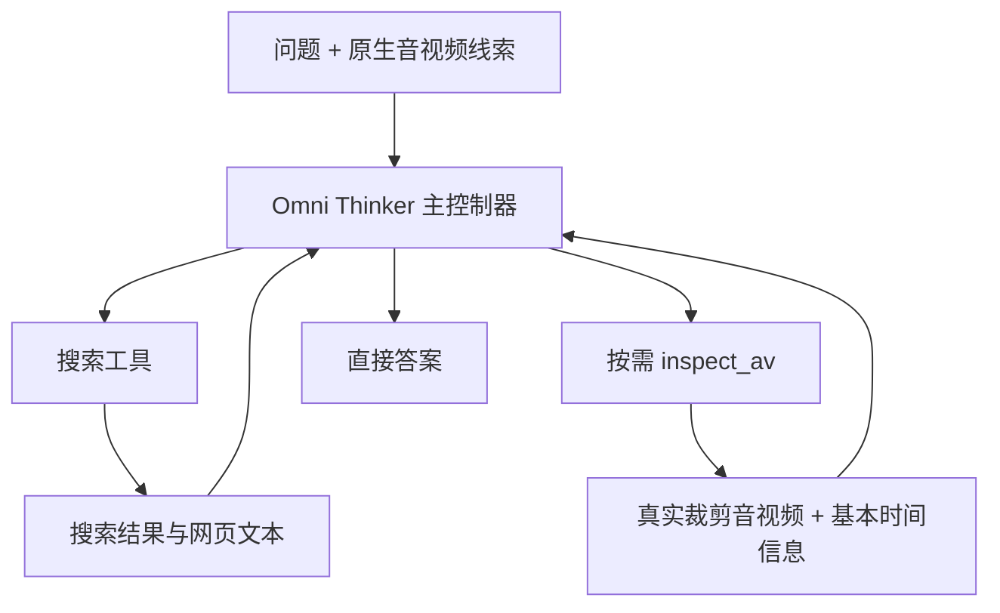

# OneSearch-AV 原生 Omni 主控制器方案 v4

日期：2026-10-12。依据用户本轮“后续是不是应该直接接入 Omni 模型”的架构修正。任务仍为 OneSearch 式音视频搜索问答；Search for Generation 保留后续工作。本文替代 v3 中“公开 OneSearch-VL-8B controller + 固定 Omni 文字 observer”为主线的设定，其他任务定义、数据隔离、指标与来源家族划分要求继续沿用。

## 核心决定

主线直接使用原生音视频 Omni 模型作为 agent：问题和真实音视频进入同一模型，模型生成搜索查询、媒体检查调用、读取调用和最终答案。第一步使用当前已准备的 Qwen2.5-Omni-7B；模型升级可作为后续独立对照。Talker 不参与文本搜索问答，使用 Thinker 生成工具动作与答案。

复用 OneSearch-VL 的仓库、推理循环、工具协议和 SFT 数据/训练设施，在模型执行器和消息转换中增加原生 AV 支持。OneSearch-VL-8B 保留视觉搜索 baseline；原先“Omni 描述文字 -> OneSearch 8B”的实验路径保留作 modular baseline 与历史工程验证。

Qwen3-VL 的 OneSearch 8B 与 Qwen2.5-Omni 的骨干不同，不能直接把 OneSearch 的权重或 LoRA 挂到 Omni。迁移对象是框架、工具协议、可用训练轨迹与搜索策略监督；如需要迁移已学策略，应通过经过筛选的轨迹蒸馏，再在 Omni 上训练。

## 主模型信息流

首个线索与后续 inspect_av 结果都须实际进入 processor 的音频/视频张量。文字可补充来源信息、时间区间或工具错误，但不能替代主线的音视频内容。检索阶段暂用现有冻结语料，开放网络检索接入单独标记。

## 本次源码检查的依据

当前 HEAD：96ee97398361645e361b09eca7cc7281aa2befbb，主仓库在 coder ssh 3 的 /home/jovyan/OneSearch-VL。

- `research/av_train/searchqa.py:183` 的 LocalOmniController 继承 text-only 的 __call__，identity 明确是 text_with_fixed_av_observations。因此仅选择现有 --controller-kind omni 并不实现原生 AV agent。
- `research/av_agent/qwen_omni_backend.py` 已使用 Qwen2_5OmniProcessor、process_mm_info 与 use_audio_in_video=True，具有真实联合 AV 模型输入的实现依据，但当前是受限的单窗口 observer，不是主控制器。
- `SFT/src/llamafactory/data/mm_plugin.py` 有 Qwen2OmniPlugin 和 use_audio_in_video 分支。
- `SFT/src/llamafactory/data/template.py` 注册 qwen2_omni。
- `SFT/src/llamafactory/model/loader.py:179` 将 qwen2_5_omni 加载后的模型取为 thinker。

上述表明源码具备接入与训练组件；不等于原生 AV 搜索循环、正确多轮媒体保留或 GPU 训练已经通过验证。

## 最小代码整合

1. 在官方模型执行器接口增加 Omni runner。原始问题带音视频，搜索结果是文字，检查结果附真实 AV；统一历史中保留这些媒体，使用官方 Omni processor 处理，明确 return_audio=False。
2. 复用官方 run_agent_loop 的动作解析、轨迹与工具返回机制，扩展消息转换来保留音视频。原版 Qwen3-VL runner 继续用于对照。
3. 将 inspect_av 接进原版工具框架，返回原片段裁剪路径与基本时间元数据；搜索后端允许冻结语料与后续网络服务替换。数据准备及评估仍放在 research/，避免再维护第二套主模型循环。
4. 媒体处理采用官方 helper 与合理的裁剪/重采样，记录真实时长、抽帧 FPS、缺失音频和必要偏移。取消普通问答不需要的严格 CFR 证明、接近零点首帧门槛与精确偶数 duration×fps 门槛；min/max pixels 明确一致。正常 VFR 与非零首帧偏移应能处理；时间定位精度仅在对应任务中验证。
5. 在实际音视频输入条件下收集自主工具轨迹，转换为 qwen2_omni 训练数据。核对初始和后续媒体均未遗漏、特殊媒体 token 与张量匹配、assistant 工具动作/答案的 labels 正确，输入与工具观察不作为答案目标训练。

## 训练与比较

先冻结音频/视觉 encoder，训练 Thinker 的语言决策部分 LoRA，让模型在原生 AV 输入条件下学会搜索；收益明确后再考虑 encoder 或 projector 解冻。原生 AV 输入与全参数训练是两件事，第一阶段无须全量更新所有模块。

主比较固定 Omni 起点、数据、搜索索引与推理预算：

| 模型 | 训练/工具条件 | 要回答的问题 |
|---|---|---|
| Omni Direct | 原生 AV，不使用外部检索 | 外部搜索是否带来收益 |
| Omni Search Prompted | 原生 AV，提示使用搜索与媒体工具 | 未训练搜索 agent 的起点 |
| Omni Search Answer-only SFT | 相同 AV 输入与训练题，监督最终答案 | 答案监督本身的贡献 |
| Omni Search Trajectory SFT | 相同 AV 输入与训练题，监督工具动作和最终答案 | 搜索轨迹监督的增益 |

回答监督两种设置都应使用可比数据与预算，报告实际监督 token 与训练计算量。另做同一 Omni 的 audio-only、video-only 消融，确认联合声画线索收益。旧 OneSearch 8B 与模块化路线是附加系统对照，不用于隔离同一 backbone 的训练效果。

## 执行里程碑

- M1：真实 10–30 秒 AV 可生成一个工具调用；搜索返回后同一 history 可生成下一动作/答案。用实际音视频张量与多轮输入验证，不能以类名或 import 成功代替。
- M2：首批 16 development candidates 在原生 Omni 路径完成逐题搜索轨迹。先诊断执行和语义错误，答案 gold 仍需核实。
- M3：扩大独立录制来源和真实轨迹，先建立数百条可用训练轨迹，再扩到 2K pilot。候选来源、候选轨迹、可训练样本分别计数。
- M4：执行 prompted / answer-only / trajectory 同条件比较，主看 Answer Accuracy，分析检索命中、查询质量与音频/视频贡献。

既有 GPU 授权继续适用，不因更换主控制器重复申请。新任务先确认原生输入路径并记录真实计算；失败产物保留。单个机械样本或 optimizer 更新不代表方法有效。

## 当前状态

本次完成架构修正和源码可复用性核对；尚未实现新的 Omni 主控制器、修改主推理行为或执行原生 Omni 搜索训练。本文件是后续开发路线，不是实验结果。

## 执行进度入口（2026-10-12 更新）

本文件保留制定时的架构/执行计划。原生 Omni、原 trainer SFT 工程验证与强 teacher 生产代码已推进；最新规模、输入契约与执行证据见 `docs/research/OneSearch-AV-Teacher-SFT-Plan-v1-2026-10-12.md` 和对应 teacher execution 文档。不能把旧计划的“尚未实现”字段当作当前代码状态。
