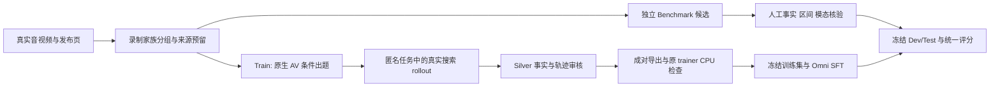

# OneSearch-AV：论文构想、研究方案与投稿计划

版本：v3，2026-10-15。中文研究与投稿工作文档，供研究讨论、合作者沟通和英文论文写作使用。执行状态核对至北京时间 2026-10-15 18:44；完整规模与后续方法按研究目标表述，已完成实验附原始证据。v3 补入同题训练进展、三版 dev prompt 结果、精确媒体绑定的质量统计及数据吞吐分析。

**工作标题：OneSearch-AV: Learning to Search from Audio-Visual Clues**
**中文标题：OneSearch-AV：学习从音视频线索出发搜索与回答**

**一句话定位：让一个原生 Omni 模型学会把“看到、听到的线索”转化为有效搜索，找到片段之外的知识并正确回答；以可规模化的数据引擎、独立 benchmark 和同基座训练实验形成完整论文。**

本文聚焦第一篇 audio-video search。任务沿用 OneSearch-VL 的搜索问答范式：输入音视频和问题，模型自行检查线索、检索、读取来源并给出答案。来源数量随问题需要决定，答案可以简短；Search for Generation 作为后续独立工作。

---

## 摘要式研究概述

音视频模型能够描述片段中的内容，而从未命名的声画线索出发获取外部知识，需要将感知、查询与证据读取连接为连续决策。本研究提出 OneSearch-AV 研究框架：以原生音视频和可核实事实构造搜索问题，通过实际工具执行生成可学习轨迹，并在统一 Omni 基座上训练搜索策略。计划建设 20K 训练问题及 200 dev / 1K test 的独立 AVSearch-Bench，围绕音乐、赛事和现场活动开展评测，以同题监督对照和模态干预解释训练收益。现有 500 题 pilot 已完成 250 次真实训练更新，在 39 道已判定的 heldout silver 问题中完成 23 道搜索问答；后续通过强 prompted baseline、同题 answer-only 和独立人工 benchmark，建立正式性能结论。

## 1. Motivation：为什么值得研究

真实音视频问题经常从一个尚不知道名称的对象或事件开始。用户能提供一段音乐表演、比赛报道或现场活动，却未必知道作品名、赛事名或活动名称。模型需要先从声音和画面获得可搜索的线索，再检索片段里没有直接提供的属性。这条从感知到知识的链路，决定了音视频模型能否解决超出片段描述的问题。

我们已构建并提供审核的实际案例包括：从高中男子冰球加时赛报道定位赛事年份；识别摩托车特技表演所属活动；从演奏片段查找练习曲作品；根据背景音乐定位曲名与创作者。这些题型体现了研究对象的共同结构：**音视频提供身份线索，搜索提供外部知识。** 用户已确认音乐、赛事和现场活动适合作为下一批扩产重点。

视觉搜索 agent 为这一问题提供了直接起点。OneSearch-VL 将视觉定位、实体检索和事实组合组织成数据、训练与评测体系 [1]。原生 Omni 模型则提供了统一接收声音和画面的基础能力 [8]。我们要研究的是：如何通过数据和训练，使这些感知能力稳定进入实际搜索决策，并提高任务成功率。

声音的作用需要落到具体搜索行为中。乐曲可能提供画面无法确定的作品身份，解说可能帮助辨认赛事，设备声可能与可见操作一起缩小候选范围。模型是否听到了这些信息，与它能否据此构造查询、找到正确来源并读出事实，是不同层次的能力。本文以任务成功率检验整条链路，同时分析声音如何改变查询和来源选择。

本研究集中回答三个问题：

1. **训练收益：** 同一个 Omni 基座学习真实搜索轨迹后，能否优于充分调好的 prompted search 和同题 answer-only SFT？
2. **信息收益：** 在哪些自然问题中，声音与画面的结合能够提高来源检索和最终回答成功率？
3. **数据收益：** 原生 AV 条件构造、模态分层和有执行依据的轨迹筛选，是否比普通数据采样更有效？

## 2. 论文定位与预期贡献

建议将论文定位为 **以性能增长为目标的音视频搜索数据与训练研究**。数据构建方法是论文主体之一，benchmark 提供独立检验，训练后的模型展示数据的实际价值。创新集中在这条可验证链路，不需要先引入新的网络结构或优化器。

### 2.1 预期贡献一：可规模化的 AV-grounded 搜索轨迹数据引擎

构建从真实声画线索到外部事实问题、再到实际工具轨迹的生产方法。teacher 在出题时接收真实音视频及发布者材料；执行任务时只接收匿名片段、问题和合法工具，自行搜索并回答。最终保留具有事实支持的轨迹，导出同题 trajectory / answer-only 训练对照。

完整交付目标为 **20K 个不同训练问题对应的合格搜索轨迹**，另有 500 个来源独立的 train-validation 问题。每条录制最多构造两个不同事实问题。数据引擎的研究价值由问题可解性、声画线索作用、有效产率和下游训练收益共同证明。

### 2.2 预期贡献二：面向自然音视频线索的独立搜索 benchmark

建设 **AVSearch-Bench：200 dev + 1,000 test**，按原始录制家族与训练集隔离。每题保存匿名 AV、自然问题、可接受答案、事实支持来源、关键区间及模态角色。通过原声、静音、只听声音和 video + ASR 对照，区分视觉、声学、语言信息与搜索各自的贡献。

Benchmark 的重点是衡量“从未知名称的自然声画线索找到知识”的能力，并通过强 baselines、来源召回和逐阶段分析给出可解释结果。正式题目不根据待测模型的胜负筛选。

### 2.3 预期贡献三：训练原生 Omni 搜索模型并解释收益来源

以 **Qwen2.5-Omni-7B** 为统一主基座，复用 OneSearch-VL agent loop 与原训练入口，学习查询、网页阅读、片段检查和回答。通过 prompted base、answer-only SFT、trajectory SFT，以及不同数据规模和模态输入的比较，证明训练带来的搜索能力增长。

主性能路线采用 full Thinker SFT；已完成的 LoRA pilot 提供执行基础与低成本对照。最终贡献表述以独立评测中的成功率、来源检索和成本证据为依据。标准 SFT 本身作为训练配方介绍，方法价值集中在训练数据及其带来的可归因能力提升。

### 2.4 贡献与证据的对应关系

| 预期贡献 | 核心证据 | 主要图表 | 当前状态 |
|---|---|---|---|
| AV-grounded 数据引擎 | 人工抽查、构造消融、产率和训练收益 | 数据统计表、pipeline 图、构造消融表 | 已端到端运行；截至 18:44，988 问题通过 silver 保留与 CPU 检查；其中 124 题完成精确输入内容抽查 |
| AVSearch-Bench | 独立来源、人工事实/模态核验、强模型比较 | benchmark 对比表、能力分组表 | 已有 43 个已物化 dev 候选；新预留批次完成 42 个 accepted 出题候选，待物化；已有 29 个录制的四模式审核；正式 human gold 为 0 |
| Learned OneSearch-AV | 同基座、同题、同工具和预算的训练比较 | 主结果表、数据规模曲线 | 500 题 trajectory LoRA 已训练及评测；同题 answer-only 已执行至 165/250 更新；三版 prompt 已完成 dev 选择实验 |

### 2.5 与 OneSearch-VL 的继承和新增

| 层次 | 本文的安排 | 在论文中的角色 |
|---|---|---|
| Agent loop、工具交互、原 SFT 入口 | 复用 OneSearch-VL 主干 | 可复现的研究基础 |
| Native AV 接口与真实媒体检查 | 同一个 Omni Thinker 接收初始和工具返回的声画 | 方法的执行载体 |
| AV 条件出题、实际搜索与成对监督 | 从自然声画线索构造可搜索问题和训练轨迹 | 数据方法贡献 |
| 独立 AVSearch-Bench | 来源隔离、事实与模态角色核实、统一检索环境 | 评价贡献 |
| 同基座监督、规模和模态实验 | 对照 prompted、answer-only、trajectory 与数据策略 | 性能和能力发现 |

论文要建立的中心结论是：**真实声画条件下构造的搜索轨迹，能够让一个统一 Omni 基座学到可迁移的知识搜索行为。** 新增代码、训练数据量和接口适配分别在实现与资源章节交代；贡献由数据质量和任务成功率的证据来支撑。

## 3. Related Work：与最近工作的关系

相关工作围绕四条线组织：视觉 deep research、音频驱动检索、原生 Omni agent，以及搜索轨迹学习。下面引用的方向性描述已核对公开论文；外部论文中的性能不混入我们的结果。

### 3.1 视觉 deep research 与 OneSearch-VL

OneSearch-VL 以 Visually Grounded Evidence Graph（VGEG）连接视觉 anchor、实体、来源支持事实和答案运算，并以此组织数据构建、过程监督和评测 [1]。正文工具表包含图像操作、图像/文本搜索和视频时间段/帧选择。它是我们选择搜索问答范式、复用 agent loop 和轨迹训练的主要依据。

VideoRover 研究视频检查、检索与网页浏览的交替执行 [6]；AdaVDR 研究自适应工具使用、反思以及面向模型能力的轨迹构建 [4]。这些工作说明工具组合与视频搜索训练已经形成具体研究路径。本文的比较重点是原生声画线索如何进入搜索，以及相应的数据与训练是否提高成功率。

VideoResearchAgent 研究 grounded task synthesis、本地视频模拟环境与 open-web video research 训练 [5]。我们当前采用冻结检索快照以支持可复现比较；若后续增加开放网络迁移，应另列实验证据，不把冻结库成绩直接解释为开放 web 成绩。

### 3.2 音频驱动的搜索

Omni-DeepSearch 从一个或多个音频片段出发，要求模型主动获取跨模态证据并回答可验证问题 [2]。它已经明确研究声音线索、查询构造和多步搜索。因此，本文的研究机会在于同步 AV 场景、可规模化训练数据和同基座学习分析，而不是将“声音可以用于搜索”本身作为新发现。

### 3.3 原生 Omni agent

OmniGAIA 与 OmniAtlas 是最直接的 Omni agent 近邻：前者构建跨音频、视频、图像与工具的任务，后者研究主动感知和轨迹训练 [3]。原生 AV 输入、主动听看、轨迹 SFT 都需要放在这一已有背景中讨论。

我们的预期增量是以 OneSearch 式搜索问答形成一套连贯资源与实证研究：自然声画线索驱动的数据生产、独立且可做模态干预的 benchmark，以及固定 Omni 基座上的监督方式和规模比较。论文通过这些具体交付建立价值，并用对照验证哪一部分产生性能增长。

### 3.4 搜索轨迹蒸馏与行为学习

LiteSearch-VL 研究小型多模态模型的轨迹蒸馏与步骤偏好学习，并关注工具协议迁移和答案核验 [7]。这与我们当前 pilot 中“训练后更能完成工具循环”的现象相关。正式实验需要同时衡量协议完成和事实成功，确认轨迹监督在强 prompted baseline 之上的贡献。

### 3.5 直接比较矩阵

| 工作 | 研究重点 | 与本工作的关系 | 本文对应实验 |
|---|---|---|---|
| OneSearch-VL [1] | 视觉 grounding、检索、事实组合、训练 | 主要代码与研究范式起点 | 原视觉模型在相同 QA 环境的参照；AV 输入消融 |
| Omni-DeepSearch [2] | 从音频出发主动跨模态搜索 | 声音检索需求的直接背景 | audio-only / native AV；检索与回答分别评分 |
| OmniGAIA / OmniAtlas [3] | 原生 Omni agent、主动感知与训练 | 原生架构和训练的最近近邻 | 同工具强 Omni baseline；监督方式与数据策略比较 |
| AdaVDR [4] | 自适应工具、反思、轨迹构造 | 工具策略与后续方法升级参照 | 普通成功轨迹与新增 AV 数据策略对比 |
| VideoResearchAgent [5] | grounded 合成、本地模拟环境与开放网络训练 | 训练环境和迁移研究参照 | corpus 规模分析；后续开放 web 迁移 |
| VideoRover [6] | 视频检查与外部检索交替 | 闭环视频搜索参照 | 检查/检索路径及失败阶段分析 |
| LiteSearch-VL [7] | 小模型轨迹蒸馏、步骤偏好 | 监督和协议迁移参照 | prompted / answer-only / trajectory；final completion 单列 |

本文不以“首次”作为当前定位。新颖性落到数据方法、独立评价和受控训练证据，英文相关工作将围绕这些比较轴展开。

## 4. 任务定义

输入为问题 \(q\) 与匿名真实 AV 片段 \(c=(V,A)\)。模型维护实际执行历史 \(h_t\)，选择动作 \(a_t\)，接收工具返回 \(o_t\)，最终输出答案 \(y\)：

\[
a_t\sim\pi_\theta(a_t\mid q,V,A,h_t),\qquad
h_{t+1}=h_t\oplus(a_t,o_t).
\]

当前可执行工具是 `text_search`、`visit_webpage` 和 `inspect_av`。后续检查返回真实裁剪媒体与基本时间信息。所有推理条件共用冻结 corpus、工具实现和预算；direct QA 条件不提供搜索工具。

Actor 只接收问题、匿名 AV 和合法工具返回。发布者答案、构造时的身份线索、私有参考、来源映射和未来 observation 均留在构造/评分侧。检索发现的合法网页可以包含身份和事实，模型应通过实际行动取得它们。

一道主搜索题应满足三个条件：当前输入确实包含相关对象或事件；声画中有合理的辨认或检索路径；回答所请求的知识需要识别具体来源/实体或查询外部属性。困难题可以保留，事实不充分、身份无法合理关联的题进入修改或裁决。

## 5. 方法：从 AV 线索到可学习的搜索行为

### 5.1 模块一：AV 条件问题构造

teacher 同时接收真实 AV 片段和发布者材料，以最多两个不同事实问题形成候选。AV 负责约束“输入里实际存在什么”，发布者材料负责提供可核实的外部事实。问题保留自然指代，身份和答案线索存于私有构造记录。

已实现的候选结构包括 `question`、`visual_cue`、`audio_cue`、`media_matches_description`、`external_information_required` 和 `fields`。答案字段要求有发布者原文支持。v3 prompt 已在新生产批次实际使用，强化实体在当前区间中出现、问题不泄露身份线索，以及外部属性具有可检索连接。

当前选段策略从原录制约 20% 处取最多 30 秒，保留真实音轨；审核页面另外提供附近 60–90 秒来源上下文，短录制按实际长度展示。后续将比较当前固定选段与线索覆盖更好的区间选择，重点验证所问对象和辨认线索是否真正覆盖在模型输入中。

**这一模块要证明：** 相比仅根据 publisher text 出题，原生 AV 约束能提高媒体匹配、可解性及有效搜索题产率，并带来下游成功率收益。

### 5.2 模块二：实际搜索轨迹合成与筛选

出题与执行分开。teacher 执行匿名任务时不接收参考答案或构造 cue，自行调用工具。系统保存每轮输入、真实 observation、媒体及 final，再由同一 teacher 服务的另一次调用进行自动 silver review，核对答案、事实支持和轨迹。

保留轨迹导出成两份严格配对数据：

- **Trajectory：** 初始 AV、问题、完整工具交互，以及模型实际生成的回答。
- **Answer-only：** 相同初始 AV、问题和实际 final，去掉工具历史。

同一个问题的两个导出共同计为一个训练问题。原 trainer 的 CPU 检查验证原生音视频、监督标签、user/tool masking 和序列长度，只有完成检查的成对数据进入 `verified_pool()`。

**这一模块要证明：** 相同题目和基座下，学习真实搜索路径比只学习最终答案更有助于自主检索和任务完成；同时报告 teacher 生成、审核和 CPU 检查各阶段的产率与成本。

### 5.3 模块三：原生 Omni 搜索策略训练

主基座固定 `Qwen/Qwen2.5-Omni-7B`，revision `ae9e1690543ffd5c0221dc27f79834d0294cba00`。初始片段和后续 `inspect_av` 返回都进入同一个原生 Omni Thinker。复用 `onesearch_vl/onesearch_infer/pipeline.py` 和 `SFT/src/train.py`。

轨迹 SFT 采用标准 masked objective：

\[
\mathcal L_{\mathrm{SFT}}(\theta)
=-\mathbb E_{\tau\sim\mathcal D}
\left[\frac{1}{\sum_i m_i}\sum_i m_i\log\pi_\theta(y_i\mid y_{<i},x)\right].
\]

其中 \(m_i=1\) 对应模型生成的推理、工具命令和 final，工具 observation 作为条件上下文。训练目标让策略学习从线索形成 query、根据结果选择来源、必要时检查媒体，并在取得事实后结束。

主性能路线为 full Thinker SFT：冻结音视觉塔与 projector，训练语言推理部分，Talker 不参与。候选初始配置为 2 epochs、LR \(10^{-5}\)、有效 batch 16、32K 序列上限；真实 GPU smoke 和 dev 结果之后冻结正式 recipe。LoRA rank 8 的已完成 pilot 作为基础对照保留。该 full 配置当前通过字段/schema 与 CPU meta 预检，尚无 full SFT 的实际 optimizer 更新结果。

### 5.4 面向性能的两个方法增强

下列增强围绕已识别的性能瓶颈开展，先在 2K 做单因素比较，通过后再推广到正式规模。

| 增强方向 | 具体改动 | 对照 | 目标收益 | 状态 |
|---|---|---|---|---|
| A. 模态分层的数据混合 | 按真实声音/画面作用组织训练样本；增加声音和联合线索题，保留视觉/语言控制 | 同题数、相同监督预算的自然采样 | 提高音频主要线索与联合子集的来源召回和成功率 | 内容抽查和候选采样已运行；真实模态分层训练待做 |
| B. 有执行依据的候选区分轨迹 | 针对相似作品/赛事/对象，在小型 dev 子集记录成功和失败查询，以及能区分候选的实际检查；用有效修正路径补充训练 | 普通成功轨迹 vs 含修正路径的同预算数据 | 减少错误实体锁定和重复搜索 | 方法候选，尚未实现与训练 |

优先执行 A，它能直接复用现有数据与模态审核。B 在错误分析确认存在稳定的实体混淆瓶颈后实施；泛化的 hard negatives、反思或 DPO 不单独承担新颖性主张。方法增强始终与普通 trajectory SFT 比较，避免把新增数据量解释成新增机制收益。

## 6. 数据构建与交付规模

### 6.1 最终目标

| 数据/产物 | 目标规模 | 用途 |
|---|---:|---|
| OneSearch-AV-Train | 20,000 个不同问题的合格轨迹 | 主 SFT 数据；目标至少 15,000 个录制家族 |
| Paired answer-only | 与 train 同题 | 监督方式对照，不增加问题计数 |
| Train-validation | 500 问题 | 训练配置、数据质量选择，来源独立 |
| AVSearch-Bench dev | 200 问题 | prompt、推理预算、judge 校准 |
| AVSearch-Bench test | 1,000 问题 | 冻结主结果；与 train/dev 家族隔离 |
| 冻结检索快照 | 暂按至少 10K 媒体来源及配套网页规划 | 目标源与同类干扰源共同检索 |

2K 是下一阶段 pilot，5K/10K/15K 为扩产里程碑，20K 为正式训练集目标。训练规模曲线使用 500/2K/5K/10K/20K；各规模从同一 pinned base 初始化。

### 6.2 领域与题型

依据用户最新审核，下一阶段候选采样目标为音乐 30%、赛事 30%、现场活动 20%、其他 20%。这已经落实为采集查询顺序和出题调度。查询类别只用作采样标签，实际内容和模态作用另外核实。

| 领域 | 主要问题结构 | 需要核实的连接 |
|---|---|---|
| 音乐与表演 | 作品/曲目/演奏者 → 作曲者、出处、相关属性 | 声音/画面能否辨认所问作品或表演 |
| 体育赛事 | 队伍/项目/解说/现场线索 → 赛事身份、年份、场馆 | 片段线索与具体赛事之间的对应 |
| 现场活动 | 表演/展会/庆典 → 活动名称、背景、关联人物 | 当前区间确实覆盖关键活动线索 |
| 技术与其他自然场景 | 设备/演示/动物/环境 → 可核实外部属性 | 存在可辨别的来源路径，保留有意义的控制题 |

若 pilot 确认自然素材供给支持此分布，benchmark 可按 dev 60/60/40/40、test 300/300/200/200 冻结领域目标。它替代早期五类均分的暂定配额；正式 test 分布在 pilot 后一次性确定，不根据模型成绩调整。

模态角色独立于领域：联合 AV、声音主要、视觉主要、语音/文本控制。初始规划为 40%/20%/30%/10%，属于待 pilot 校准的标注目标。某一音乐题可以视觉为主，某一技术题也可以声音关键；不以领域代替模态标签。

### 6.3 端到端 pipeline

采集和生成直接运行在 `coder ssh 3` 的 CPU 后台；GPU 训练/推理使用已授权的集群 launcher。每批来源先预留 benchmark，再进入训练出题。实际训练 observations 中出现过的 URL 和媒体哈希也参与隔离检查。

### 6.4 Benchmark 标注

首批以 100 题构建 pilot 校准标注流程，计入未来 dev。Reviewer 独立看片段并尝试解题，再核对答案、来源、关键区间及模态角色；两人分歧由第三人裁决。自动建议折叠显示，保留人类独立选择。

审核区分四件事：问题自然且可解；事实有来源支持；身份与当前 AV 能关联；声音/画面在这道题中起什么作用。正式 gold 来自实际核实，用户确认题型方向不等于逐题答案已成为 gold。

每题提供原声、真实去音轨视频、audio-only 和足够的来源上下文。训练题型审核包和独立 benchmark 审核包分别保存。最新 benchmark 包含 24 道题、24 个不同录制，提供四种媒体模式；120 个媒体/静帧文件完成哈希核对，96 次 HTTP Range 请求均返回 206，首题四模式均完成浏览器实际播放。自动审核为 23 completed / 1 failed，语义与模态角色继续逐题核实。

### 6.5 数据管线作为论文贡献如何验证

论文报告每阶段候选量、保留率、不同录制数、题型/模态分布、事实字段、时长和 tokens。重点实验是 AV 条件构造 vs publisher-text-only、自然采样 vs 模态分层，以及 ordinary trajectory vs 新增强轨迹的数据收益。

生成调用、自动审核和人工抽查分别计数。API 金额按实际账单/usage 记录；来源、媒体与私有事实的版本链路支撑重建。发布包包含可分发的数据或获取/裁剪脚本、训练配置、评测代码和数据卡。

## 7. Benchmark 与实验设计

### 7.1 核心 baseline panel

| 条件 | 模型与监督 | 要回答的问题 |
|---|---|---|
| B0 | Qwen2.5-Omni-7B，direct QA | 感知与参数知识能解决多少 |
| B1 | 同基座，充分调好的 prompted search | 不训练的强搜索起点 |
| B2 | 同基座，同题 answer-only SFT | 最终答案蒸馏的作用 |
| B3 | 同基座，普通 trajectory SFT | 搜索过程监督的作用；OneSearch-AV 核心模型 |
| B4 | 同基座，trajectory + 经验证的数据增强 | 数据策略的额外收益 |
| B5 | 原 OneSearch-VL-8B，视觉输入 | follow 原工作的参照 |
| B6 | video + ASR 模块化搜索 | 原生 AV 与语音转写方案的差别 |
| B7 | 强闭源 native AV 模型，共用工具与索引 | 能力上界参照和费用轴 |

先把 B0–B3 跑扎实；B4 取决于 2K 数据消融，B5–B7 构成外部比较。B5 采用相同冻结检索环境时属于工具环境适配评测，原版工具/服务复现另列，避免将环境差异混为模型差异。

B1 的 prompt 在独立 dev 上调整后冻结，few-shot 只来自 train。B2 和 B3 测试时使用相同工具、prompt 和预算，另列 no-search 成绩。主比较同时报告相同 epochs 与近似训练计算量，记录 context/supervised tokens、updates 和 GPU 时间。

### 7.2 主指标与评分

**Task Success** 是主指标：在预算内形成合法完整 final，所有请求事实正确且无实质矛盾。它由实际 episode 状态与语义评分联合决定。逐字段正确率用于分析部分正确。

**Supported Success** 进一步要求主要断言有实际已见来源支持。**Source Retrieval** 报告合法目标或替代有效来源的检索命中、实际读取情况；固定 reference URL 命中作为可复现代理单列，不要求所有正确解法使用同一路径。

成本报告真实工具调用、重复调用、媒体秒数、输入/输出 tokens、时延、GPU 时间和 API 费用。主方法比较按录制家族做配对 bootstrap；正式主模型和关键 answer-only 对照以 3 个 seed 为目标。

评分按两个层次实现：当前 pilot 的 `supported_success` 核对给定 publisher reference 的一致性；正式 Evidence-supported success 将主要断言逐条绑定到 actor 实际已见的工具 observation，并单列证据覆盖率。Judge 先在至少 200 个由人评分的 dev 系统回答上校准，再冻结 rubric 和模型。任务执行失败进入分母；judge 失败标为 unknown，同时报告全体任务完成上下界。

### 7.3 模态与机制实验

| 实验 | 固定条件 | 核心结论 |
|---|---|---|
| 原声 AV / 静音视频 | 同题、权重、工具与预算，初始及工具媒体一起去音轨 | 声音可用性改变了多少成功率与来源选择 |
| Audio-only / video + ASR | 同题，记录额外转写成本 | 非语音声学线索、语言信息与视觉各自作用 |
| No-search / search | 同权重、AV | 外部知识获取的增量 |
| Answer-only / trajectory | 同题、初始化、训练计算报告 | 搜索路径监督的贡献 |
| 普通采样 / 模态分层 | 同题数和训练预算 | 数据配比是否改善目标能力 |
| Text-only / AV-conditioned authoring | 共同来源池和生成预算 | 原生 AV 约束的构造与下游价值 |
| 500/2K/5K/10K/20K | 同基座和 recipe，固定嵌套成员 | 数据规模与成功率关系 |
| Corpus 1K/5K/10K | 固定题目和 query budget | 干扰密度与来源区分能力 |

### 7.4 失败分析与性能迭代

按线索识别、query、来源选择、媒体检查、事实提取、final 六阶段标注。开发集分析优先定位三种可行动问题：身份线索没有进入查询；查询锁定错误实体后重复检索；来源已找到但事实提取或结束行为出错。

数据迭代针对 dev 错误增加对应轨迹，使用新的冻结模型复评。Test 在主实验前冻结，不参与选题、prompt 或数据策略调整。主文用最能解释训练增量的案例，完整逐题结果留在附录与发布包。

## 8. 已有实验结果与当前进展

### 8.1 当前数据与 benchmark

状态核对时间：北京时间 2026-10-15 17:40。运行明细和阶段快照保存在配套研究记录中。

| 项目 | 已确认数量/状态 | 下一阶段产物 |
|---|---|---|
| 合格训练池 | **979 个不同问题**，silver 保留与原 trainer CPU 检查均完成 | 冻结 2K paired train，随后扩到 20K |
| 等待 CPU 审核 | 0 | 随新搜索轨迹继续更新 |
| 数据生产 | 训练 producer 与 benchmark worker 进程身份均核验存活 | 按优先题型继续扩产 |
| 新增 benchmark dev 候选 | 43 个问题；另有较早的 19 题 / 14 录制候选 | 逐题事实、区间与模态核实，去重后入库 |
| 最新 benchmark 四模式审核包 | 24 题 / 24 录制；23 次自动审核完成、1 次失败 | 首批人工构建 pilot |
| 正式人工 benchmark gold | 0 | 200 dev + 1K test |
| 同题 500 answer-only 控制 | 数据冻结、配置和 CPU schema 预检通过 | 实际训练、保存重载和同题评测 |
| Full Thinker 路线 | 配置/schema 与 CPU meta 预检完成 | GPU smoke 后执行正式训练 |

问题候选、成功轨迹和通过训练检查的数据分别计数；paired answer-only 与 trajectory 共享同一个问题计数。训练和 benchmark 来源在出题前分组预留。用户对优先题型与继续推进的认可用于确定研究方向，正式 gold 依据逐题核实记录建立。

### 8.2 500 条轨迹 SFT：已完成的 pilot

本轮训练包含 500 个问题、494 段原始录制，使用原 `SFT/src/train.py`。Thinker LoRA rank 8 / alpha 16 / dropout 0.05，LR $10^{-4}$，有效 batch 4，2 epochs，完成 **250 次真实 optimizer updates**。权重、optimizer/scheduler/RNG 状态以及 checkpoint 重载检查已完成。

评测共 56 题，划分为 heldout silver 40 题和 dev 16 题。固定 prompt、greedy、8 turns、每 turn 最多 512 输出 token；六组同题 rollout 均已执行。匿名配对 silver judge 完成 54/56，两个集合各有 1 题 unknown。

| 模型与输入 | Heldout 成功 / 已判定 | Task success | Dev 成功 / 已判定 | Task success |
|---|---:|---:|---:|---:|
| 原始 base，AV | 0/39 | 0.0% | 0/15 | 0.0% |
| clean500 trajectory SFT，AV | **23/39** | **59.0%** | 8/15 | 53.3% |
| clean500 trajectory SFT，静音 | 21/39 | 53.8% | 13/15 | 86.7% |

训练后的策略已经能完成一批从原生 AV 输入到工具搜索再到最终答案的任务。当前 base 的工具协议完成率低；强 prompted base 将在独立 dev 上选定 prompt 后，与 answer-only 和 trajectory 一起使用同一 prompt、工具和预算比较。这样可以进一步区分协议习得、答案蒸馏与搜索决策的收益。

Heldout 的 AV–静音差为 **+5.1 pp**，按录制家族 bootstrap 的 95% 区间为 [−8.1, 19.4] pp；dev 差为 **−33.3 pp**，区间 [−46.7, −14.3] pp。两组结果用于确定下一阶段的模态分层和错误分析，正式声音作用结论由独立模态标注与匹配对照建立。

Heldout AV 对全部 40 题的完成上下界为 57.5%–60.0%，dev AV 对全部 16 题为 50.0%–56.25%。这两个范围由 unknown 造成，与置信区间分别报告。旧 172 条模型保留为历史记录；其中 18/40 heldout 参考页面曾出现在训练 observation，不纳入正式干净规模曲线。

### 8.3 同题 answer-only：已冻结的关键对照

同题控制复用 clean500 的全部成员、初始 AV 和 pinned base。answer-only 的 `<response>` 与 trajectory 实际 final 中的 `<response>` 逐题相同，移除工具历史及 final 前的 think。全体 1,000 个 paired rows 的哈希、原有媒体与标签审核和处理代码身份已核对；原 trainer 参数与数据注册预检通过。

| 每 epoch 的训练输入 | Trajectory | Answer-only |
|---|---:|---:|
| 不同问题数 | 500 | 500 |
| Context tokens | 4,053,859 | 2,442,485 |
| Supervised tokens | 112,947 | 29,999 |
| 最大序列 tokens | 20,014 | 5,834 |

控制配方与已完成 trajectory LoRA 相同：rank 8、LR $10^{-4}$、batch 4、2 epochs、250 updates、seed 42，配置差异为数据集和输出目录。同题 answer-only 已于 18:10 提交实际 GPU 训练，18:44 快照为 **165/250 次真实 optimizer updates**，checkpoint-125 已生成；这不是完整训练结论。原 trainer 的保存与状态核验、模型重载、56 题原声和 56 题静音 rollout，以及随后最多 56 次匿名同题评分，已串成同一次执行流程。正式比较记录实际 token、更新数、GPU 时间，并补近似等计算量分析。

### 8.4 数据质量：从内容核实到训练收益

100 个不同录制的分层原生 AV 自动抽查已完成：91 次请求完成、9 次失败。统一规则得到 **66 keep、15 perception-control、4 revise、6 reject、9 unknown**。这是按采集 query 分层的自动审核结果，用于指导构造改进；后续质量表分别报告随机抽样人工核实与各领域/模态分层统计。

已识别的构造改进集中在三个环节：题干保留自然指代；所问对象与关键线索覆盖在实际输入区间；AV 身份线索能够连接到所请求的外部事实。音乐、赛事和现场活动作为下一批优先来源，按 30% / 30% / 20% 调度，其余 20% 保留其他自然场景与控制题。

### 8.5 当前证据如何进入论文

现有 500 题结果展示了真实数据、原生 Omni 和原 OneSearch 训练主干的端到端学习路径。正式主表将以 **strong prompted base → 同题 answer-only → trajectory SFT → 经验证的数据策略** 为比较链，统一报告任务成功率和成本。规模曲线与独立 benchmark 进一步检验学习收益的可扩展性；模态干预解释模型在什么条件下利用声音与画面。

### 8.6 Prompted base：已完成的 dev 实验与下一步比较

在固定的 16 道 development 题上，比较原始 prompt、简化工具 prompt 和带两个真实训练轨迹示例的 prompt。两个示例来自训练集，选择未读取 heldout。复用 16 个旧 rollout，新增 32 个 rollout；16 次匿名按题评分全部完成。

| Prompt | 协议 final / 16 | 实际工具调用总数 | Task success | 文本字节数 |
|---|---:|---:|---:|---:|
| p0：原始 | 2 | 2 | 0/16 | 6,350 |
| p1：简化工具说明 | 16 | 0 | 0/16 | 2,422 |
| p2：简化说明 + 训练示例 | 16 | 0 | 0/16 | 12,730 |

预先固定的 tie rule 选择 p1，但三者尚未建立有效的 prompted search baseline。对全部 48 个首轮输入逐题回读，确认 system、题目和实际声画 tensors 均已进入模型；p1/p2 的原始生成直接给 final。目前没有建立 runner/parser 丢失工具调用的证据。下一步将用独立 dev 区分工具协议输出能力与声画线索构造查询能力，再把选定的完整执行配置一致应用于 base、answer-only 和 trajectory。此处选择结果不进入正式 test 结论。

### 8.7 训练池的内容质量与模态覆盖

将已有自动内容抽查与 988 个合格问题按 **题干、实际训练初始媒体 SHA 和审核结果 SHA** 连接，得到 124 个精确输入对应的已查问题。此前不同抽查包存在不属于最终保留池的候选，因此不直接相加各包题数。

| 当前质量视图 | 不同问题数 | 用途 |
|---|---:|---|
| Main search candidate | 92 | 搜索主训练集候选 |
| Perception control | 21 | 单独控制集 |
| Needs revision | 4 | 修改后重新验证 |
| Exclude candidate | 7 | 剔除队列 |
| Not content audited | 864 | 待内容抽查，不自动视为 keep |

124 题中的自动模态角色为 joint 26、visual-primary 84、audio-primary 7、speech-text-primary 7。它们反映已查交集，不能当作全部训练池或新优先批次的比例。已保留原始 exports，后续 2K 主训练 freeze 显式应用质量分组。原始导出通过 CPU 检查，表示媒体、标签与训练输入成立；搜索任务内容质量由这一层补充核实。

为扩大覆盖，本轮另启动最多 **128 道此前未抽查录制**的精确输入自动审查，4 workers，直接在 Coder CPU 执行。按固定随机优先级选取、每个原始录制至多一题，排除已付费成功、失败或未知的审核输入；不使用 student 成绩选题。该新审核不计入上述 124 个完成量，结果单独版本化。

### 8.8 数据引擎的实际吞吐与优先扩产

新优先批次已取得 250 个可用音视频，预先保留 50 个候选录制家族给 benchmark；127 个录制通过训练侧准备。首个 48-recording author chunk 得到 48 个 accepted 问题，来自 29 个录制，下一步进行真实工具 rollout、silver review 与 CPU 核验。Benchmark 新预留批次完成 50 次 author attempts，44 完成、6 失败，得到 42 个 accepted 问题；49 个 raw 提议不作为 49 道保留题报告。以上均未提前加入合格训练题或正式 benchmark。

494 条请求 timing 显示：出题 109 次，平均 23.27 秒；rollout 中单次请求 300 次，平均 9.45 秒；silver review 85 次，平均 12.88 秒，峰值均为 8 个并发。模型等待和解析约占单次请求时长的 99.7%–99.9%，本地请求准备约 0.02–0.03 秒。采集、媒体物化、家族清点与 CPU 标签核验不在这一请求准备计时内；阶段跨度有重叠和空隙，不相加为总 wall time。

后续吞吐优化分别测量下载与媒体阶段、跨题 API 并发和单题多轮调用；单题 observation 依赖前一个 action，保持因果顺序。生产中的冻结源码保持原版本，性能改动进入新 run，与当前同批工作量比较。费用按实际 provider 账单记录，当前 token usage 不换算成假定美元成本。

## 9. 论文结构与图表规划

建议英文正文按以下顺序展开：

1. **Introduction：** 从音乐/赛事自然案例切入，提出感知线索进入搜索决策的问题，概述数据、benchmark 和训练结果。
2. **Related Work：** 围绕视觉搜索、audio-driven search、Omni agents 和轨迹学习说明位置。
3. **Task and AVSearch-Bench：** 输入/动作/评分定义、来源与模态分层、人工构建。
4. **Audio-Visual Search Data Engine：** AV 条件出题、实际 rollout、筛选和数据统计。
5. **Learning OneSearch-AV：** 原生模型、masked trajectory SFT、训练配方和经验证的数据增强。
6. **Experiments：** 主表、监督方式、模态分析、数据规模与构造消融。
7. **Analysis and Conclusion：** 线索到 query 的行为、失败阶段和主要发现。

| 图表 | 要传达的记忆点 | 证据来源 |
|---|---|---|
| Figure 1 | 一个真实声画线索如何引出搜索并找到外部事实 | 人审通过的音乐或赛事完整案例 |
| Figure 2 | 数据引擎、Train/Bench 分支与原生 Omni 训练 | 实际 pipeline 与数据统计 |
| Figure 3 | 训练规模与成功率，附监督/模态对照 | 冻结模型的独立评测 |
| Table 1 | 与最近 benchmark / agent 的能力定位 | 直接近邻正文和本研究任务定义 |
| Table 2 | 数据与 benchmark 的规模、领域、模态、时长 | 最终 release 与人工标注 |
| Table 3 | 强基线与训练后 OneSearch-AV 的成功率和成本 | 正式 test |
| Table 4 | 数据构造、监督方式和性能增强的可归因收益 | 固定 dev/test 消融 |

主要叙事围绕性能与能力发现，工程恢复、请求明细和运行过程归入实验总账与附录。

## 10. 投稿计划

### 10.1 建议投稿定位

**近期建议目标为 CVPR 2027 主会**：论文围绕音视频线索理解、外部知识检索、训练数据和独立 benchmark 展开，符合多模态视觉研究方向。该选择是投稿建议，尚未代用户决定最终 venue。

官方 CFP 当前公布：**Paper Enrollment 为 2026-11-10 23:59 AoE，全文 Submission 为 2026-11-16 AoE，补充材料为 2026-11-23 AoE** [9]。Enrollment 对应北京时间 11 月 11 日 19:59；全文与补充材料以官网/投稿系统显示的具体时间为准。

从当前日期到全文截止约一个月，建议按“前两周拿决定性结果、后两周完成规模与写作”的冲刺节奏组织。20K train、200 dev、1K test 保持完整交付目标；在阶段检查中依据实际产率和标注资源决定是否进入该窗口。

若核心证据形成需要更完整的 7–8 周周期，后续研究窗口考虑 ICML 2027；若主要贡献集中为数据资源、benchmark 与系统性发现，也可评估后续 NeurIPS 数据集与 benchmark 相关征稿。此次访问对应 2027 页面未获得日程，本文不填写未经确认的截止日期。

### 10.2 CVPR 冲刺执行表

下表是目标安排，不是当前完成承诺。数据生产、人工标注、训练对照和写作并行，范围与正式交付目标保持一致。

| 时间 | 主要工作 | 阶段交付 |
|---|---|---|
| 10/15–10/19 | 首批扩产、2K pilot；可视化案例和事实/模态审核；补 strong prompted 与 500 answer-only | 2K 冻结候选、首批人审 pilot、匹配对照 |
| 10/20–10/26 | 2K full Thinker 与数据策略比较；推进 5K/10K；持续 benchmark 双审 | 第一轮可归因训练结果、构造质量统计 |
| 10/27–11/02 | 扩到 20K；完成 200 dev + 1K test 的构建与冻结；固定 recipe/prompt | 数据 release candidate、统一评测配置 |
| 11/03–11/09 | 正式主模型与关键控制、多 seed、完整 test 和消融；完成主要图表 | 主表、规模曲线、模态与成本分析、全文初稿 |
| 11/10–11/16 | Enrollment、论文核对与提交；对已有结果做统一复算 | 完整主文与可追溯实验包 |
| 11/17–11/23 | 补充材料、复现说明、更多案例与发布清单 | Supplement 和代码/数据交付草案 |

**两个决策日期：** 10 月 26 日检查 2K 主比较、数据有效产率和人工标注进度；11 月 9 日检查完整结果、数据与稿件。若转入后续投稿窗口，继续完成同一研究目标，不将阶段性试验改写成完整论文。

### 10.3 工作量与资源

20K 训练数据的生成需求按实际“合格问题/录制”重估：若产率为 0.5、0.8、1.2，分别约需 40K、25K、16.7K 次候选录制处理。生产日志持续记录 retained/hour 和 CPU-qualified/hour，以实际吞吐决定并发和采集规模。

1,200 题双审按每人每题 12–20 分钟估计为 **480–800 人时**；若 20% 需要第三人 10 分钟裁决，另约 40 人时。若安排三周、15 个工作日并行完成，双审约需每天 32–53 总人时，相当于约 6–9 人每天各 6 小时，再计裁决。100 题 pilot 先测真实耗时，团队人数是资源规划变量。

GPU 预算以新 full Thinker smoke 和实际 token 吞吐重测。旧 500 题 LoRA 约 1 H20Z 小时，可用于理解现有 pilot 成本，不能直接当作 full Thinker、多 seed 和全部消融的预算。数据生成与 GPU 训练分别排队，每次训练结束立即接同题评测。

## 11. 接下来最值得完成的四项工作

1. **形成可训练的 2K 数据冻结。** 让新批次完整经过真实搜索、silver review 和 CPU 检查；同时检查新优先题型的事实与区间。
2. **补齐决定性训练对照。** 强 prompted base、同题 answer-only、trajectory SFT；full Thinker 先实际 smoke，再执行正式训练与即时评测。
3. **把 benchmark 从候选推进到人审 gold。** 先完成 100 题构建 pilot，固定模态审核与评分，再扩到 200 dev / 1K test。
4. **用独立 dev 选择一个能增长性能的数据策略。** 优先模态分层；按失败阶段决定是否增加候选区分轨迹，正式 test 保持冻结。

这四项完成后，论文可以清楚回答：数据如何构建、模型学会了什么、收益来自哪里，以及在独立音视频搜索任务上有多大价值。

## 12. 代码、结果与审核入口

主代码统一位于 `coder ssh 3:/home/jovyan/OneSearch-VL`，环境由 Pixi 管理。

| 入口 | 路径 |
|---|---|
| 原 agent loop | `/home/jovyan/OneSearch-VL/onesearch_vl/onesearch_infer/pipeline.py` |
| Native Omni runner | `/home/jovyan/OneSearch-VL/onesearch_vl/onesearch_infer/omni_runner.py` |
| AV 条件出题 | `/home/jovyan/OneSearch-VL/research/av_train/question_authoring.py` |
| 真实轨迹生产与合格计数 | `/home/jovyan/OneSearch-VL/research/av_train/scale_searchqa.py` |
| 来源隔离 | `/home/jovyan/OneSearch-VL/research/av_train/source_isolation.py` |
| 成对导出与 CPU 核验 | `/home/jovyan/OneSearch-VL/research/av_train/native_sft.py` |
| 原训练入口 | `/home/jovyan/OneSearch-VL/SFT/src/train.py` |
| 当前训练数据生产 | `/home/jovyan/OneSearch-VL/research/runs/av-data-production-20261015-v7/` |
| 当前 benchmark 生产 | `/home/jovyan/OneSearch-VL/research/runs/av-reserved-benchmark-20261015-v4/` |
| 500 题同题 answer-only 控制 | `/home/jovyan/OneSearch-VL/research/runs/av-learning-500-controls-20261015-v2/` |
| Dev prompt 比较与输入诊断 | `/home/jovyan/OneSearch-VL/research/runs/av-strong-prompt-dev-20261015-v1/` |
| 精确训练输入质量视图 | `/home/jovyan/OneSearch-VL/research/runs/av-train-quality-view-20261015-v1/` |
| 128 题新增内容抽查 | `/home/jovyan/OneSearch-VL/research/runs/av-train-content-audit-128-20261015-v2/` |
| 500 题原始评测 | `/home/jovyan/OneSearch-VL/research/runs/av-learning-500-eval-20261015-v2/learning-results.private.json` |

可播放的用户审核入口：

- [训练题型与模态审核](http://127.0.0.1:8781/OneSearch-AV-Modality-Review-2026-10-15/train-quality-review/index.html)
- [独立 benchmark 24 题四模式审核](http://127.0.0.1:8781/OneSearch-AV-Benchmark-Review-v3-2026-10-15/benchmark-modality-review/index.html)
- [新增 24 个训练与 5 个 benchmark 案例](http://127.0.0.1:8781/OneSearch-AV-New-Data-Review-2026-10-15/index.html)

本文远端正文为 `docs/research/OneSearch-AV-Paper-Dossier-v3-2026-10-15.md`，配套证据目录为 `docs/research/records/2026-10-15-paper-dossier-v3/`。当前快照、原始结果来源哈希和文档校验随版本归档。文献部分继承 v1 的独立上下文核验；v3 保持 related work、方法、投稿日程和参考文献的已核验正文，补入作者自己的实验进展。原始请求、逐题参考答案、媒体与私有训练记录保留在 Coder 主项目。用户的“kyd”按继续执行理解，逐题事实和模态审核按页面记录单独导入。

## 参考文献

[1] Hongyu Li et al. **OneSearch-VL: Unified Multimodal Deep Research Agent for Image and Video.** arXiv:2610.12419, 2026. [论文](https://arxiv.org/abs/2610.12419) · [官方代码](https://github.com/appletea233/OneSearch-VL).

[2] Tao Yu et al. **Omni-DeepSearch: A Benchmark for Audio-Driven Omni-Modal Deep Search.** arXiv:2605.08762, 2026. [论文](https://arxiv.org/abs/2605.08762).

[3] Xiaoxi Li et al. **OmniGAIA: Towards Native Omni-Modal AI Agents.** arXiv:2602.22897, 2026. [论文](https://arxiv.org/abs/2602.22897).

[4] Xintong Zhang et al. **AdaVDR: Adaptive Tool Use and Reflection for Video Deep Research.** arXiv:2608.25559, 2026. [论文](https://arxiv.org/abs/2608.25559). 本文按 2026-10-15 访问版本核对；该文在 2026-10-14 有修订。

[5] Yuhang Zhou et al. **VideoResearchAgent: Grounded Task Synthesis and Sim-to-Real RL for Open-Web Video Research.** arXiv:2610.04911, 2026. [论文](https://arxiv.org/abs/2610.04911).

[6] Wenqi Liu et al. **Thinking Beyond Videos: Unifying Video Reasoning and Deep Research for Open-World Video Agents.** arXiv:2608.23329, 2026. [论文](https://arxiv.org/abs/2608.23329).

[7] Saeed Khaki, Nima Safaei, Kamal Ginotra. **LiteSearch-VL: Small Multimodal Search Agents via Trajectory Distillation and Synthetic Step-DPO.** arXiv:2608.29357, 2026. [论文](https://arxiv.org/abs/2608.29357).

[8] Jin Xu et al. **Qwen2.5-Omni Technical Report.** arXiv:2503.20215, 2025. [论文](https://arxiv.org/abs/2503.20215) · [模型](https://huggingface.co/Qwen/Qwen2.5-Omni-7B).

[9] **CVPR 2027 Call for Papers.** 官方征稿与时间表，访问日期 2026-10-15. [官网](https://cvpr.thecvf.com/Conferences/2027/CallForPapers).
